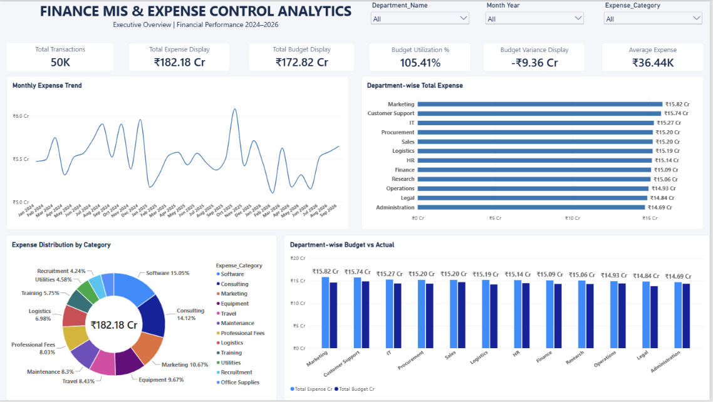
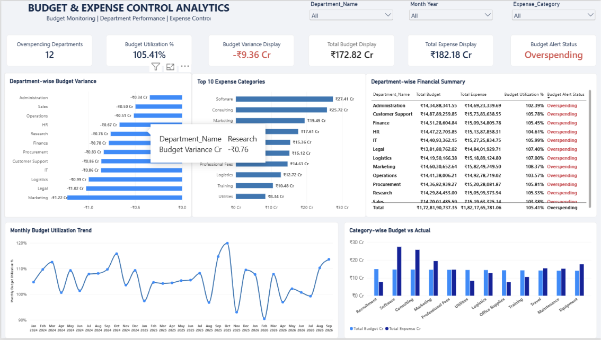
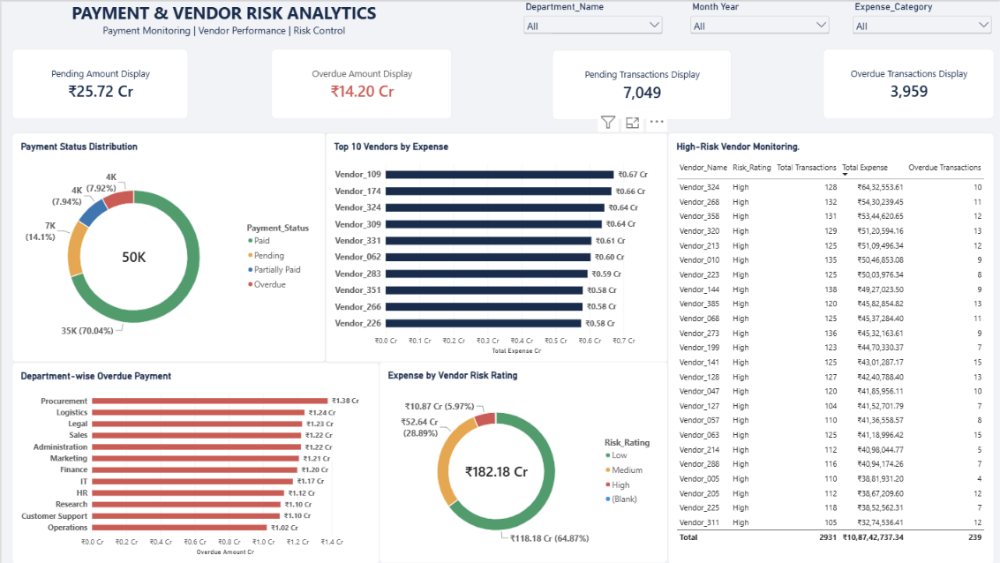
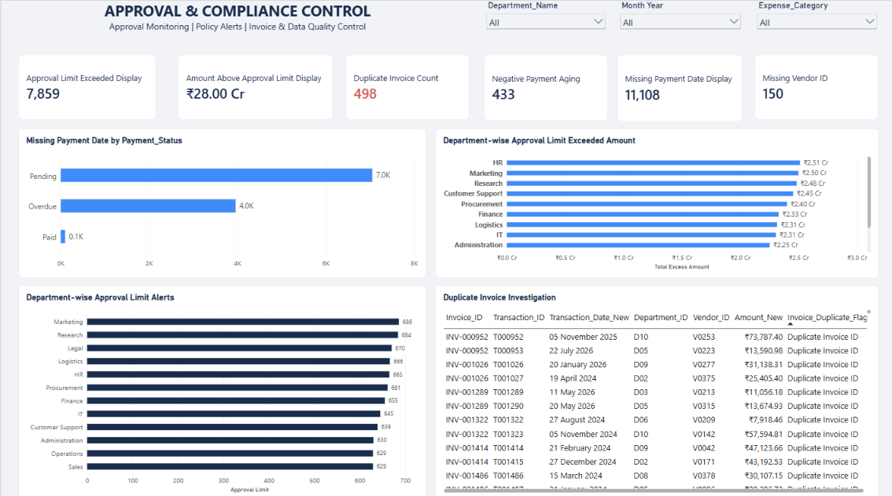
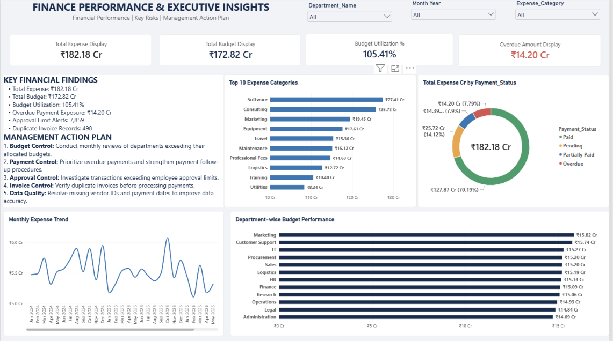

# Finance MIS & Expense Control Analytics System

## Project Overview
An end-to-end Finance MIS and Expense Control Analytics project built using Excel, Power Query, MySQL, SQL, Power BI, and DAX.

The project analyzes 50,000 financial transactions to monitor expenses, payment performance, vendor risk, and budget utilization.

## Tools & Technologies
- Excel
- Power Query
- MySQL
- SQL
- Power BI
- DAX

## Dataset
The project uses five datasets:
- Transactions – 50,000 rows
- Departments – 12 rows
- Vendors – 400 rows
- Employees – 150 rows
- Monthly Budget – 4,752 rows

## Key Activities
- Data cleaning, validation, and standardization
- Identification of missing values, duplicate invoice IDs, and inconsistent categories
- SQL-based financial analysis using joins, aggregations, CTEs, and window functions
- Department-wise expense and budget vs. actual analysis
- Payment status, overdue payment, and vendor risk analysis
- Power BI dashboard development with DAX measures and KPIs

## Power BI Dashboard
The interactive dashboard contains five pages:
1. Executive Overview
2. Budget & Expense Control
3. Payment & Vendor Risk
4. Approval & Compliance
5. Executive Insights & Recommendations

## Dashboard Preview

### 1. Executive Overview

### 2. Budget & Expense Control

### 3. Payment & Vendor Risk

### 4. Approval & Compliance

### 5. Executive Insights & Recommendations

## Repository Structure
- `Documentation/` – Project report
- `SQL/` – SQL analysis scripts
- `PowerBI/` – Power BI dashboard
- `Dashboard_Screenshots/` – Dashboard screenshots

## Project Objective
To build a financial reporting and expense control system that helps monitor spending, identify payment risks, and support data-driven business decisions.
